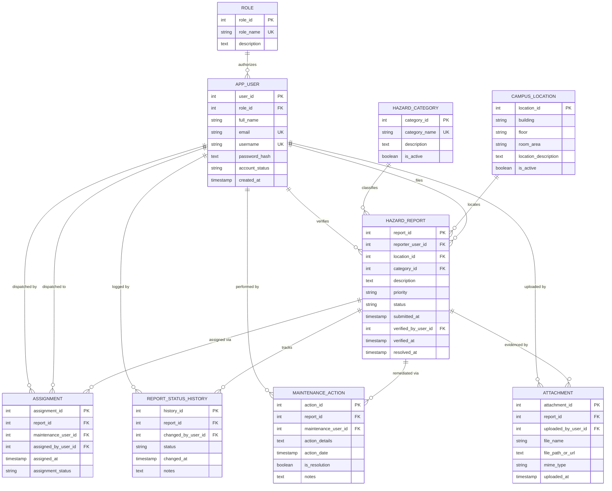

# CampusSafe — Entity Relationship Diagram (ERD)

**System:** CampusSafe: Campus Hazard & Safety Reporting System  
**Database:** `grp07_campussafedb`  

---

## 1. Mermaid Entity-Relationship Diagram

---

## 2. Cardinality and Referential Rules Summary

1. **`app_user` &rarr; `hazard_report` (1:N):**
   - A user may submit 0 or many hazard reports.
   - Every report must have exactly one reporter (`reporter_user_id NOT NULL REFERENCES app_user(user_id)`).
   - Deletion of an `app_user` with existing reports is restricted (preventing orphan records).

2. **`hazard_report` &rarr; `assignment` (1:N):**
   - A report may have multiple assignments over time if escalated or transferred, but only one active assignment per technician (`UNIQUE (report_id, maintenance_user_id)`).
   - `ON DELETE CASCADE`: If a test report is purged, its assignments are automatically removed.

3. **`hazard_report` &rarr; `report_status_history` (1:N):**
   - Every report has at least one status history entry created on initial submission (`Submitted`), plus one entry for each transition.
   - `ON DELETE CASCADE`.

4. **`hazard_report` &rarr; `maintenance_action` (1:N):**
   - A report in progress records technician logs; final action has `is_resolution = TRUE`.
   - `ON DELETE CASCADE`.

5. **`hazard_report` &rarr; `attachment` (1:N):**
   - Reports can contain multiple photo/document attachments.
   - `ON DELETE CASCADE`.
