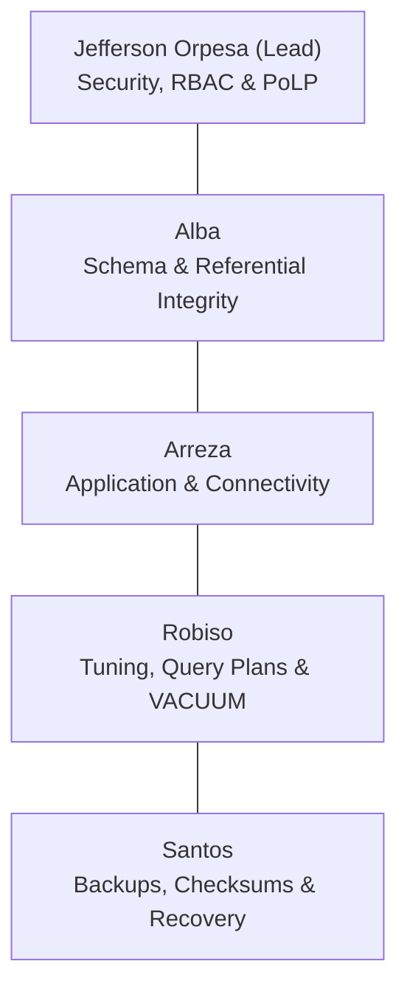

# COMP 018: Database Administration - Midterm Examination
## In-Person Integrated Challenge Battle Playbook & Runbook

**Course:** COMP 018 - Database Administration  
**Group:** Group 7 (CampusSafe)  
**Members:** Jefferson Orpesa (Lead), Alba, Arreza, Robiso, Santos  
**Repository:** [https://github.com/jeffersonorpesa2-ops/grp07-campussafe](https://github.com/jeffersonorpesa2-ops/grp07-campussafe)  
**Database Platform:** PostgreSQL 18.6 on x86_64 Windows  
**Primary Database:** `grp07_campussafedb`  
**Disposable Challenge Database:** `grp07_campussafedb_disposable`  

---

## 🎯 Executive Overview & Golden Rules

This playbook provides Group 7 with a complete, end-to-end tactical system for the in-person midterm assessment. In this challenge, every group plays two distinct roles:
1. **Designer Group:** Audits an assigned peer group's database, logs evidence-based flaws in the `Flaw Register`, and designs 5 balanced incident scenarios with fault/reset scripts.
2. **Owner Group:** Receives 5 incident briefs designed by another group against CampusSafe, executes a disciplined investigation on a disposable database copy, applies surgical fixes, and verifies recovery.
3. **Oral Defense:** Each member orally defends their architectural, security, performance, and recovery decisions before the instructor.

> [!CAUTION]
> ### 🚨 The 3 Cardinal Rules of the Midterm Challenge:
> 1. **NEVER test or run fault scripts on the live `grp07_campussafedb`!** Always spin up and operate exclusively inside `grp07_campussafedb_disposable`.
> 2. **NEVER use lazy superuser (`postgres`) grants to fix an access issue!** Use the principle of least privilege (PoLP) and grant only the specific missing permission (`USAGE`, `SELECT`, `INSERT`, etc.).
> 3. **NEVER leave secrets or passwords in public sheets or git commits!** All tracker entries and markdown files must remain sanitized.

---

## ⚔️ PART 1: Designer Group Playbook (Attacking Your Assigned Peer)

When the instructor announces your assigned peer project in class:

### Step 1.1: Check if the Peer is One of Our 8 Pre-Audited Projects
Group 7 has already audited, reproduced, and documented the schemas, access controls, maintenance states, and backups of 8 groups in the class. If assigned to one of them, **do not waste time starting from scratch**:

| Assigned Group | Project Name | Target Database | Full Audit & Vulnerability Report Link |
|---|---|---|---|
| **Group 2** | Park-It: Smart Parking | `grp_parkitdb` | [`progress-report/GROUP_02_PARKIT_EVALUATION_REPORT.md`](file:///E:/programming%20project/Data%20Ad/progress-report/GROUP_02_PARKIT_EVALUATION_REPORT.md) |
| **Group 3** | Project OJT RMA | `ojt_managementdb` | [`progress-report/GROUP_03_OJT_RMA_EVALUATION_REPORT.md`](file:///E:/programming%20project/Data%20Ad/progress-report/GROUP_03_OJT_RMA_EVALUATION_REPORT.md) |
| **Group 4** | BrewPOS: Coffee Point-of-Sale | `grp_brewposdb` | [`progress-report/GROUP_04_BREWPOS_EVALUATION_REPORT.md`](file:///E:/programming%20project/Data%20Ad/progress-report/GROUP_04_BREWPOS_EVALUATION_REPORT.md) |
| **Group 5** | Lost & Found System | `grp05_lostandfounddb` | [`progress-report/GROUP_05_LOSTANDFOUND_EVALUATION_REPORT.md`](file:///E:/programming%20project/Data%20Ad/progress-report/GROUP_05_LOSTANDFOUND_EVALUATION_REPORT.md) |
| **Group 6** | HabalGo: Ride-Hailing | `grp00_habalgodb` | [`progress-report/GROUP_06_HABALGO_EVALUATION_REPORT.md`](file:///E:/programming%20project/Data%20Ad/progress-report/GROUP_06_HABALGO_EVALUATION_REPORT.md) |
| **Group 8** | bwisIT Campus Canteen | `grp08_canteendb` | [`progress-report/GROUP_08_CANTEEN_EVALUATION_REPORT.md`](file:///E:/programming%20project/Data%20Ad/progress-report/GROUP_08_CANTEEN_EVALUATION_REPORT.md) |
| **Group 10** | Binary Sisters Restaurant | `grp_binarysisters_projectdb` | [`progress-report/GROUP_10_RESTAURANT_EVALUATION_REPORT.md`](file:///E:/programming%20project/Data%20Ad/progress-report/GROUP_10_RESTAURANT_EVALUATION_REPORT.md) |
| **Group 11** | BoardTrack: Rental System | `grp11_boardtrackdb` | [`progress-report/GROUP_11_BOARDTRACK_EVALUATION_REPORT.md`](file:///E:/programming%20project/Data%20Ad/progress-report/GROUP_11_BOARDTRACK_EVALUATION_REPORT.md) |

### Step 1.2: If Assigned to a New Group (Rapid Audit Protocol)
If paired with a group outside the 8 above (e.g. Group 1 or Group 9), connect to their database and execute our pre-built audit script:
```powershell
psql -U postgres -d <peer_database_name> -f "E:\programming project\Data Ad\midterm\designer\scripts\audit_peer_project.sql"
```
The script automatically tests and outputs:
1. Primary key presence across all base tables.
2. Foreign key columns missing indexes (causing sequential table lockups).
3. Blanket permissions (`SUPERUSER`, `CREATEDB`) granted to runtime accounts.
4. User credential tables exposing plaintext or bcrypt hashes without security views.
5. High dead-tuple bloat and un-analyzed tables.
6. Sequence state synchronization.

---

### Step 1.3: The Universal 5-Incident Design Pack
Use this balanced, instructor-compliant design pack for whichever project you are auditing:

#### 🟢 Incident 1: Privilege & Sequence Lockout (Activity 4)
* **Flaw Reference:** Application runtime account lacks `USAGE, SELECT` on identity sequences.
* **Difficulty:** Easy &bull; **Time:** 15 mins
* **Public Brief (Symptoms Only):**
  > *"Operational staff report that attempting to create a new record or submit a new form causes the application to crash immediately with a database permission denied error, blocking all new entries."*
* **Public Evidence:** PostgreSQL log shows `ERROR: permission denied for sequence ..._seq`.
* **Private Fault Script:**
  ```sql
  REVOKE USAGE, SELECT ON ALL SEQUENCES IN SCHEMA public FROM <peer_app_role>;
  ```
* **Private Reset Script:**
  ```sql
  GRANT USAGE, SELECT ON ALL SEQUENCES IN SCHEMA public TO <peer_app_role>;
  ```
* **Expected Root Cause:** Runtime role was granted table `INSERT` but lacks sequence execution rights needed by `nextval()`.

---

#### 🟡 Incident 2: Security Abstraction & Hash Exposure (Activities 3 & 4)
* **Flaw Reference:** User credential table exposes bcrypt hashes directly to reporting/auditor roles.
* **Difficulty:** Medium &bull; **Time:** 20 mins
* **Public Brief (Symptoms Only):**
  > *"Auditors report that the compliance directory export fails with an 'object does not exist' error. Security scanning indicates that querying the base user table directly exposes sensitive password hashes."*
* **Public Evidence:** Query log shows `ERROR: relation "v_user_directory" does not exist`.
* **Private Fault Script:**
  ```sql
  DROP VIEW IF EXISTS v_user_directory CASCADE;
  ```
* **Private Reset Script:**
  ```sql
  CREATE OR REPLACE VIEW v_user_directory AS
  SELECT user_id, username, full_name, role_name, created_at FROM app_user JOIN user_role USING (role_id);
  GRANT SELECT ON v_user_directory TO <peer_auditor_role>;
  ```
* **Expected Root Cause:** Abstraction security view missing; auditor granted raw table access exposing credentials.

---

#### 🟡 Incident 3: Table Bloat & Query Degradation (Activity 5)
* **Flaw Reference:** Missing index on status lookup columns combined with unpruned MVCC dead tuples.
* **Difficulty:** Medium &bull; **Time:** 25 mins
* **Public Brief (Symptoms Only):**
  > *"Front-desk dashboard response times have degraded from under 100 ms to over 3,500 ms during peak hours. Filtering for active/pending records causes CPU usage to spike to 95%."*
* **Public Evidence:** `EXPLAIN (ANALYZE, BUFFERS)` reveals a high-cost `Seq Scan`; `pg_stat_user_tables` shows high `n_dead_tup`.
* **Private Fault Script:**
  ```sql
  DROP INDEX IF EXISTS idx_<entity>_status;
  -- Generate dead tuples via dummy updates
  UPDATE <entity> SET updated_at = NOW() WHERE status = 'PENDING';
  ```
* **Private Reset Script:**
  ```sql
  CREATE INDEX idx_<entity>_status ON <entity>(status);
  VACUUM (VERBOSE, ANALYZE) <entity>;
  ```
* **Expected Root Cause:** Stale table statistics and dropped index forcing sequential scans across dead tuple pages.

---

#### 🔴 Incident 4: Backup Service Authorization Failure (Activity 6)
* **Flaw Reference:** Dedicated backup role stripped of read privileges, producing invalid 0-byte dumps.
* **Difficulty:** Hard &bull; **Time:** 30 mins
* **Public Brief (Symptoms Only):**
  > *"The nightly automated backup cron job terminated with exit code 1 at 01:00 AM. The generated backup archive is 0 bytes in size, and restoration attempts fail with an invalid archive header error."*
* **Public Evidence:** Scheduled task log shows `pg_dump: error: query failed: ERROR: permission denied for table ...`.
* **Private Fault Script:**
  ```sql
  REVOKE pg_read_all_data FROM <peer_backup_role>;
  REVOKE SELECT ON ALL TABLES IN SCHEMA public FROM <peer_backup_role>;
  ```
* **Private Reset Script:**
  ```sql
  GRANT pg_read_all_data TO <peer_backup_role>;
  ```
* **Expected Root Cause:** Backup principal lacks global schema read privileges under the principle of least privilege.

---

#### 🟢 Incident 5: Sequence Desynchronization Collision (Free Choice)
* **Flaw Reference:** Primary key sequence counter desynchronized from existing table IDs.
* **Difficulty:** Easy &bull; **Time:** 15 mins
* **Public Brief (Symptoms Only):**
  > *"Users attempting to submit an entry receive an immediate database crash: 'duplicate key value violates unique constraint'. Even though the form is blank, the database reports that ID 1 already exists."*
* **Public Evidence:** Error message `SQLSTATE[23505]: Unique violation: Key (id)=(1) already exists.`
* **Private Fault Script:**
  ```sql
  ALTER SEQUENCE <entity_id_seq> RESTART WITH 1;
  ```
* **Private Reset Script:**
  ```sql
  SELECT setval('<entity_id_seq>', (SELECT COALESCE(MAX(<id>), 0) FROM <entity>));
  ```
* **Expected Root Cause:** Sequence current value was manually altered or restarted below the maximum existing primary key.

---

## 🛡️ PART 2: Owner Group Playbook (Defending CampusSafe)

When your designer group releases their 5 Incident Briefs for CampusSafe:

### Step 2.1: Spin Up the Disposable Database (RUN FIRST!)
Execute in PowerShell:
```powershell
createdb -U postgres -h localhost -p 5432 -T grp07_campussafedb grp07_campussafedb_disposable
```
*(This instantly clones the entire CampusSafe database structure, tables, views, and data into a sandbox without affecting your live database).*

---

### Step 2.2: Run the Universal Diagnostic Suite
Execute the diagnostic script against your disposable database:
```powershell
psql -U postgres -d grp07_campussafedb_disposable -f "E:\programming project\Data Ad\midterm\owner\scripts\diagnostics\owner_diagnostic_suite.sql"
```
Review the output sections:
1. **CHECK 2 & 3:** Are all 9 tables and 1 view present? Did row counts change?
2. **CHECK 4:** Did `app_runtime_grp`, `app_readonly_grp`, or `campussafe_backup` lose any table/sequence grants?
3. **CHECK 5:** Is any sequence flag marked `CRITICAL: SEQUENCE DESYNCHRONIZED`?
4. **CHECK 6 & 7:** Are foreign keys or indexes missing?
5. **CHECK 8 & 9:** Are there uncommitted transaction locks or dead tuple bloat?

---

### Step 2.3: Quick-Lookup Emergency Fix Catalog
Match the symptom to the exact surgical fix:

| Injected Fault / Symptom | Diagnostic Indicator | Surgical SQL Fix (Run on disposable DB) |
|---|---|---|
| **Sequence permission denied on INSERT** | `permission denied for sequence ...` | `GRANT USAGE, SELECT ON ALL SEQUENCES IN SCHEMA public TO app_runtime_grp;` |
| **Table permission denied** | `permission denied for table ...` | `GRANT SELECT, INSERT, UPDATE ON ALL TABLES IN SCHEMA public TO app_runtime_grp;` |
| **Duplicate key on auto-increment INSERT** | `Key (report_id)=(1) already exists` | `SELECT setval('hazard_report_report_id_seq', (SELECT MAX(report_id) FROM hazard_report));` |
| **Missing security view** | `relation "v_user_directory" does not exist` | Re-create view from `database/03_roles_and_privileges.sql` and grant to `app_readonly_grp`. |
| **Slow query / missing index** | Seq Scan in `EXPLAIN (ANALYZE, BUFFERS)` | `CREATE INDEX idx_hazard_report_status ON hazard_report(status); VACUUM ANALYZE hazard_report;` |
| **Dead tuple bloat** | `n_dead_tup > 20` in `pg_stat_user_tables` | `VACUUM (VERBOSE, ANALYZE) hazard_report;` |
| **Backup fails with permission denied** | `pg_dump: permission denied for table` | `GRANT pg_read_all_data TO campussafe_backup;` |
| **Active connection lock / query hang** | `wait_event_type = 'Lock'` in `pg_stat_activity` | `SELECT pg_terminate_backend(<pid>);` |

---

### Step 2.4: Fill the 8-Step Troubleshooting Record
For each of the 5 incidents, document the following in [`midterm/owner/TROUBLESHOOTING_PLANS.md`](file:///E:/programming%20project/Data%20Ad/midterm/owner/TROUBLESHOOTING_PLANS.md) and your Google Sheets tracker:
1. **Observe:** Record exact symptoms from the peer brief.
2. **Verify:** Document the command and output proving the failure on `grp07_campussafedb_disposable`.
3. **Hypothesize:** State Hypothesis A (likely cause) and Hypothesis B (alternative explanation).
4. **Test:** Run the check that disproved Hypothesis B and confirmed Hypothesis A.
5. **Act:** Apply the minimum surgical SQL fix under the proper role (avoiding superuser).
6. **Verify Again:** Re-run the positive test (succeeds) and negative test (unauthorized access remains blocked).
7. **Document:** Record before/after metrics and resolution status (`RESOLVED 100%`).
8. **Prevent:** Provide one practical engineering recommendation to prevent recurrence.

---

## 🎓 PART 3: Oral Defense Mastery Guide (Member Roles)

The instructor will ask each member specific technical questions. Master these exact answers:



### 1. Jefferson Orpesa (Lead & Security/Access Control)
* **Q: "Why did you use group roles like `app_runtime_grp` instead of granting privileges directly to users?"**
  > **Strong Answer:** *"Role-Based Access Control (RBAC) isolates privileges from human accounts. Group roles hold no login permissions (`NOLOGIN`). Login accounts (`campussafe_app`, `campussafe_auditor`, `campussafe_backup`) inherit permissions via membership. This simplifies credential rotation and auditing without altering table grants."*
* **Q: "Why not grant superuser or `ALL PRIVILEGES` to solve a permission error?"**
  > **Strong Answer:** *"That violates the Principle of Least Privilege (PoLP). Giving `ALL PRIVILEGES` grants `DROP`, `TRUNCATE`, and `ALTER`, exposing the database to catastrophic damage from SQL injection or bugs. We grant only the exact missing privilege (such as `USAGE` on sequences)."*

### 2. Alba (Database Architecture & Schema Integrity)
* **Q: "Why did you choose `ON DELETE RESTRICT` instead of `CASCADE` on hazard reports?"**
  > **Strong Answer:** *"In an institutional safety system, incident records must be legally preserved. `ON DELETE RESTRICT` prevents accidental deletion of historic hazard reports if a user account or hazard category is removed, ensuring complete auditability."*
* **Q: "What happened when invalid data was tested against check constraints?"**
  > **Strong Answer:** *"PostgreSQL immediately rejected the insert with error `23514 (check_violation)`. Database check constraints act as the ultimate line of defense, preventing dirty state corruption even if application validation fails."*

### 3. Arreza (Application & System Integration)
* **Q: "Why does an `INSERT` fail on a `SERIAL` column even when table `INSERT` was granted?"**
  > **Strong Answer:** *"An auto-incrementing `SERIAL` column invokes the underlying `nextval()` function on a sequence. Granting `INSERT` on the table allows row insertion, but does not grant rights to advance the sequence generator. The account must explicitly be granted `USAGE, SELECT` on the sequence."*
* **Q: "How does the application prevent SQL injection?"**
  > **Strong Answer:** *"We use PHP PDO with parameterized prepared statements (`$stmt->prepare()` and `$stmt->execute([...])`). Query parameters are sent separately from the SQL statement via PostgreSQL's binary protocol, preventing input from breaking out into executable syntax."*

### 4. Robiso (Performance Tuning & Maintenance)
* **Q: "Explain the difference between a Sequential Scan and an Index Scan in query plans."**
  > **Strong Answer:** *"A `Seq Scan` reads every data page sequentially from disk/buffer to evaluate the filter condition. An `Index Scan` traverses a B-tree structure to directly pinpoint the exact tuple offset. On large tables, index scans reduce buffer hits and slash execution time from seconds to sub-milliseconds."*
* **Q: "What is a dead tuple, and why does PostgreSQL need `VACUUM`?"**
  > **Strong Answer:** *"Under PostgreSQL's Multi-Version Concurrency Control (MVCC), an update or delete leaves the old version of the row marked as dead. Dead tuples cause table bloat and memory buffer exhaustion. `VACUUM` cleans dead tuples, updates the Free Space Map (FSM), and allows space to be reused by future inserts."*

### 5. Santos (Backup, Recovery & QA Testing)
* **Q: "Why did you use `pg_dump -Fc` (custom format) instead of plain SQL dumps?"**
  > **Strong Answer:** *"The custom format (`-Fc`) includes built-in zlib compression (saving over 74% disk space), embeds a Table of Contents (TOC) metadata header that allows selective object extraction via `pg_restore`, and supports multi-threaded parallel restoration (`pg_restore -j`)."*
* **Q: "How does a Canary Disaster Recovery Drill prove recoverability?"**
  > **Strong Answer:** *"A backup file on disk does not prove data can be recovered. In our drill, we inject a tracked canary record, capture an immediate snapshot, simulate accidental deletion, restore to an isolated staging database, and verify that the canary record is recovered 100% intact."*

---

## 📋 PART 4: Class Google Sheets Tracker Rows

Keep your tracker rows updated in real time during the challenge:

### Flaw Register Tab Entry (Designer Role)
| Column | Value to Enter |
|---|---|
| **Flaw ID & Project** | `[e.g. G11-F1, Group 11 - BoardTrack]` |
| **Reported By** | `Group 7 (Alba, Arreza, Orpesa, Robiso, Santos)` |
| **Area & Activity** | `Access Control (Activity 4)` |
| **Description & Evidence** | `Runtime role lacks USAGE on sequences; INSERT fails under least privilege. Evidence: midterm/designer/scripts/audit_peer_project.sql` |
| **Severity** | `Medium` |
| **Owner Status** | `Open` *(updated by peer group)* |

### Incident Register Tab Entry (Owner Role)
| Column | Value to Enter |
|---|---|
| **Incident ID & Flaw ID** | `[e.g. G07-INC1, linked to peer flaw ID]` |
| **Project & Designer Group** | `CampusSafe (Group 7), designed by Group X` |
| **Variant & Activity Area** | `Privileges / Access Control (Activity 4)` |
| **Incident Brief & Difficulty** | `New report submission fails with permission error (Easy)` |
| **Status** | `Investigated & Resolved` |
| **Owner's Root Cause & Result** | `Runtime group lacked sequence USAGE. Applied surgical grant; 100% verified. Status: Resolved.` |
| **Report Link** | `https://github.com/jeffersonorpesa2-ops/grp07-campussafe/tree/main/midterm` |

---

## 🎒 Pre-Flight Laboratory Checklist

Before the exam begins, make sure you have:
- [x] Cloned/pulled the latest repository on your laptop: `git pull origin main`.
- [x] Verified PostgreSQL 18.6 service is running on port 5432.
- [x] Confirmed the `midterm/` folder is present with all diagnostic and audit scripts.
- [x] Bookmarked your class Google Sheets tracker in your browser.
- [x] Verified all 5 members know their assigned defense questions and answers.
