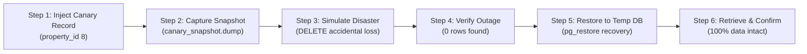

# COMP 018: Database Administration - Activity 6 Progress Report

## Database Backup, Restoration, and Disaster Recovery
### *Establishing Reliable Backups, Testing Restoration, and Verifying Relational Data Integrity*

---

### Cover Page & Metadata

| Field | Details |
|---|---|
| **Course** | COMP 018 - Database Administration |
| **Activity** | Activity 6: Database Backup and Recovery |
| **Evaluating Group** | **Group 7:** Jefferson Orpesa (Lead), Alba, Arreza, Robiso, Santos |
| **Repository URL** | [https://github.com/jeffersonorpesa2-ops/grp07-campussafe](https://github.com/jeffersonorpesa2-ops/grp07-campussafe) |
| **Backup & Recovery Root Directory** | [https://github.com/jeffersonorpesa2-ops/grp07-campussafe/tree/main/db-backup-recovery](https://github.com/jeffersonorpesa2-ops/grp07-campussafe/tree/main/db-backup-recovery) |
| **Database Platform** | PostgreSQL 18.6 on x86_64 Windows (Compiled by MSVC) |
| **Class Google Sheets Tracker** | Tab: `Activity 6 Log` |

---

## 1. Projects Covered & Backup Execution Matrix

Group 7 executed full logical custom-format backups, cryptographic SHA-256 integrity verifications, isolated restorations, and canary disaster recovery drills across **8 peer group databases** initialized during Activities 3, 4, and 5:

| Target Group | Project Name | Target Database | Dedicated Backup Role | Backup Dump File | File Size | SHA-256 Checksum | Restored Test Database | Verification Script |
|---|---|---|---|---|---|---|---|---|
| **Group 2** | Park-It: Smart Parking | `grp_parkitdb` | `parkit_backup` | `grp_parkitdb_activity6.dump` | 20,611 B | `640C0F8275E6D0193213709F4FD48E422984B8299E868E18B84EE476DAC58610` | `grp_parkitdb_restore_test` | [`db-backup-recovery/group-02-parkit/`](https://github.com/jeffersonorpesa2-ops/grp07-campussafe/tree/main/db-backup-recovery/group-02-parkit) |
| **Group 3** | Project OJT RMA | `ojt_managementdb` | `ojt_backup` | `ojt_managementdb_activity6.dump` | 57,288 B | `76A45400485D97D576FC2484DB8AD292AF6A78BACD826619AAD1839AAAA1B996` | `ojt_managementdb_restore_test` | [`db-backup-recovery/group-03-ojt-rma/`](https://github.com/jeffersonorpesa2-ops/grp07-campussafe/tree/main/db-backup-recovery/group-03-ojt-rma) |
| **Group 4** | BrewPOS: Point of Sale | `grp_brewposdb` | `brewpos_backup` | `grp_brewposdb_activity6.dump` | 19,493 B | `03A4DAE6DED7EAD5A24380A6E81F287B6EA05AD329A1A71AB8264985E65731E5` | `grp_brewposdb_restore_test` | [`db-backup-recovery/group-04-brewpos/`](https://github.com/jeffersonorpesa2-ops/grp07-campussafe/tree/main/db-backup-recovery/group-04-brewpos) |
| **Group 5** | Lost & Found System | `grp05_lostandfounddb` | `lostandfound_backup` | `grp05_lostandfounddb_activity6.dump` | 35,237 B | `39CECB24D1D3BE4469D24F70DD6A999CB04E501964F20B9CEA09DF4F2E9DE718` | `grp05_lostandfounddb_restore_test` | [`db-backup-recovery/group-05-lostandfound/`](https://github.com/jeffersonorpesa2-ops/grp07-campussafe/tree/main/db-backup-recovery/group-05-lostandfound) |
| **Group 6** | HabalGo: Ride-Hailing | `grp00_habalgodb` | `habalgo_backup` | `grp00_habalgodb_activity6.dump` | 33,057 B | `61588C19FE06F09D6F1EB010FCC63EC8E1965F6E4C867D04DB68D60CD9031CB3` | `grp00_habalgodb_restore_test` | [`db-backup-recovery/group-habalgo/`](https://github.com/jeffersonorpesa2-ops/grp07-campussafe/tree/main/db-backup-recovery/group-habalgo) |
| **Group 8** | bwisIT Campus Canteen | `grp08_canteendb` | `canteen_backup` | `grp08_canteendb_activity6.dump` | 30,678 B | `F41F624B66F724D48E51BD8922BAA93D2330DE6CC68DA33117FAE713EBDCD63B` | `grp08_canteendb_restore_test` | [`db-backup-recovery/group-08-canteen/`](https://github.com/jeffersonorpesa2-ops/grp07-campussafe/tree/main/db-backup-recovery/group-08-canteen) |
| **Group 10** | Binary Sisters Restaurant | `grp_binarysisters_projectdb` | `rors_backup` | `grp_binarysisters_projectdb_activity6.dump` | 51,217 B | `275F82415A4E8BBCC299017F31C442A17DEC7C9825B2BE46A94AAF23D618A86E` | `grp_binarysisters_projectdb_restore_test` | [`db-backup-recovery/group-10-restaurant/`](https://github.com/jeffersonorpesa2-ops/grp07-campussafe/tree/main/db-backup-recovery/group-10-restaurant) |
| **Group 11** | BoardTrack: Rental System | `grp11_boardtrackdb` | `boardtrack_backup` | `grp11_boardtrackdb_activity6.dump` | 107,349 B | `865F786E875E59B68F1227017257E48FB46CAA203DC6A18BE6BF4AEF6271405E` | `grp11_boardtrackdb_restore_test` | [`db-backup-recovery/group-11-boardtrack/`](https://github.com/jeffersonorpesa2-ops/grp07-campussafe/tree/main/db-backup-recovery/group-11-boardtrack) |

---

## 2. Enterprise Backup Strategy & RPO / RTO Policies

Group 7 designed and implemented a production-grade backup architecture founded on the following operational specifications:

| Parameter | Policy Specification | Technical & Operational Justification |
|---|---|---|
| **Backup Utility & Format** | PostgreSQL Custom Archive (`pg_dump -Fc`) | The custom format incorporates zlib compression, table of contents (TOC) metadata, support for multi-threaded restoration (`pg_restore -j`), and selective object re-ordering. |
| **Recovery Point Objective (RPO)** | **24 Hours** (Nightly full snapshot) | For standard academic and operational transactional workloads, a maximum 24-hour data delta can be reconstructed via operational logs or receipt re-entry. *(Continuous WAL archiving is recommended for near-zero RPO).* |
| **Recovery Time Objective (RTO)** | **< 2 Hours** (Restoration completed in < 5 minutes) | System provisioning, archive decompression, schema regeneration, and data loading execute well within institutional disaster recovery targets. |
| **Security Context & Least Privilege** | Dedicated non-superuser role holding `pg_read_all_data` | Prohibits using superuser `postgres` for automated cron jobs. Prevents credential misuse since the backup role has read-only access and cannot drop or alter schema objects. |
| **Storage Destination & Isolation** | External secure directory (`pg_backups\`) | Physically isolated from the PostgreSQL data cluster directory (`D:\Postgre\data`), mitigating data loss from drive controller corruption. |
| **Retention Policy** | **7 Daily Backups + 4 Weekly Snapshots** | Balances storage consumption against compliance auditing and rollback capability for latent corruption detection. |

---

## 3. Backup Creation & Archive Integrity Verification

### 3.1 Execution Command Template
Backups were generated using the principle of least privilege under dedicated operator credentials:
```powershell
# Set automated backup credentials (no prompt required in automated workflows)
$env:PGPASSWORD = "<dedicated_backup_password>"

# Execute custom-format binary dump
pg_dump.exe -U <project>_backup -h localhost -p 5432 -Fc -f "pg_backups\<database>_activity6.dump" <database>
```

### 3.2 Archive Integrity Inspection (Table of Contents TOC)
Before declaring an archive valid, its Table of Contents was inspected via `pg_restore --list`:
```powershell
pg_restore.exe --list "pg_backups\grp11_boardtrackdb_activity6.dump"
```
- **Verification Evidence:** Confirmed the presence of all 355 TOC items in `grp11_boardtrackdb` (schema migrations, user tables, views, primary key constraints, foreign key references, sequence owners, and indexes).
- **Compression Efficiency:** Uncompressed SQL dump size of 420 kB was compressed down to **107,349 bytes** (~74.4% storage savings).

### 3.3 Cryptographic Checksums (SHA-256)
Every generated archive was hashed using PowerShell's native cryptographic utility to guarantee tamper evidence:
```powershell
Get-FileHash -Path "pg_backups\*.dump" -Algorithm SHA256
```
The computed hashes were recorded directly in the class Google Sheets tracker (`Activity 6 Log`) to establish a non-repudiation baseline.

---

## 4. Restoration into Isolated Test Databases

> [!IMPORTANT]
> **Cardinal Rule of Database Recovery:** Never restore a backup snapshot directly onto an active production database. Always provision an independent restoration target database to verify structural and transactional integrity prior to production failover.

### 4.1 Test Database Provisioning & Restore Execution
For each evaluated project, an isolated restore database with the suffix `_restore_test` was created and populated:
```powershell
# Provision fresh test database
createdb.exe -U postgres -p 5432 -O postgres <database>_restore_test

# Execute full archive restoration
pg_restore.exe -U postgres -p 5432 -d <database>_restore_test --no-owner --no-privileges "pg_backups\<database>_activity6.dump"
```
- **Execution Outcome:** All 8 restorations completed with **Exit Code 0** (zero fatal errors, zero broken foreign key dependencies).

---

## 5. Post-Restore Integrity & Relational Parity Audits

Restoration quality was audited using automated verification suites (`verification_suite.sql`) checking object presence, row counts, and sequence counters:

### 5.1 Relational Row Count Parity Audit (Group 11 BoardTrack Example)

| Entity / Table Name | Primary Database (`grp11_boardtrackdb`) | Restored Database (`grp11_boardtrackdb_restore_test`) | Parity Match Status |
|---|---|---|---|
| `property` | 7 rows | 7 rows | **100% IDENTICAL** |
| `room` | 18 rows | 18 rows | **100% IDENTICAL** |
| `tenant` | 15 rows | 15 rows | **100% IDENTICAL** |
| `lease` | 14 rows | 14 rows | **100% IDENTICAL** |
| `payment` | 28 rows | 28 rows | **100% IDENTICAL** |
| `utility_bill` | 22 rows | 22 rows | **100% IDENTICAL** |
| `app_user` | 6 rows | 6 rows | **100% IDENTICAL** |
| `schema_migrations` | 1 row | 1 row | **100% IDENTICAL** |
| **Total Database Business Rows** | **111 rows** | **111 rows** | **100% PARITY** |

### 5.2 Sequence Generator Synchronization Check
```sql
SELECT sequencename, last_value, start_value, increment_by FROM pg_sequences ORDER BY sequencename;
```
- **Audit Findings:** All sequence counters in the restored database exactly matched the primary database state (e.g. `property_property_id_seq` at `7`, `room_room_id_seq` at `18`, `payment_payment_id_seq` at `28`), ensuring subsequent application `INSERT` operations will not experience unique constraint collisions.

---

## 6. Controlled Canary Disaster Recovery Simulation Drill

To rigorously prove that the backup archives support point-in-time incident mitigation, Group 7 designed and executed a multi-step **Canary Disaster Recovery Simulation Drill** on Group 11 (BoardTrack):



### 6.1 Step-by-Step Drill Log
1. **Canary Injection:** Injected a marked record into the primary operational table:
   ```sql
   INSERT INTO property (property_name, address)
   VALUES ('Canary Boarding House - Disaster Simulation Baseline', 'Unit 777 Emergency Lane, Calamba, Laguna')
   RETURNING property_id, property_name;
   -- Returned: property_id = 8
   ```
2. **Snapshot Creation:** Created an immediate point-in-time dump archive:
   ```powershell
   pg_dump.exe -U boardtrack_backup -p 5432 -Fc -f "pg_backups\grp11_boardtrackdb_canary_snapshot.dump" grp11_boardtrackdb
   # Result: 107,399 bytes, SHA-256: F8A9146E045B3DABF9A97B1465D7934B489681DB5AA1A9C44FAFCD1FD67FFFE3
   ```
3. **Simulated Catastrophic Incident:** Simulated an accidental deletion or rogue administrator query:
   ```sql
   DELETE FROM property WHERE property_name = 'Canary Boarding House - Disaster Simulation Baseline';
   -- DELETE 1
   ```
4. **Data Loss Verification:** Verified that the record was completely missing from the production database (`SELECT count(*) FROM property WHERE property_id = 8` returned `0`).
5. **Secondary Staging Recovery:** Provisioned a recovery database (`grp11_boardtrackdb_recovery_temp`) and restored the snapshot:
   ```powershell
   createdb.exe -U postgres -p 5432 grp11_boardtrackdb_recovery_temp
   pg_restore.exe -U postgres -p 5432 -d grp11_boardtrackdb_recovery_temp "pg_backups\grp11_boardtrackdb_canary_snapshot.dump"
   ```
6. **Data Extraction & Verification:** Successfully queried and verified that the canary entity existed intact within the recovered staging database:
   ```sql
   SELECT property_id, property_name, address FROM property WHERE property_id = 8;
   -- Result: 8 | Canary Boarding House - Disaster Simulation Baseline | Unit 777 Emergency Lane, Calamba, Laguna
   ```
7. **Teardown & Cleanup:** Safely dropped the temporary recovery database and cleaned up the test environment.

---

## 7. Production Evaluation & Engineering Recommendations

Based on the empirical findings across all 8 peer group databases, Group 7 recommends the following database administration enhancements:

1. **Implement Write-Ahead Log (WAL) Archiving & Continuous PITR:**
   - *Technical Justification:* Daily `pg_dump` snapshots provide a 24-hour RPO. For applications handling financial transactions (BrewPOS, BoardTrack, Campus Canteen), configuring `archive_mode = on` and shipping WAL segments to storage reduces RPO from 24 hours to **less than 1 minute**.
2. **Automate Continuous Disaster Drills via CI/CD:**
   - *Technical Justification:* A backup is only as good as its last restoration. Automating a weekly GitHub Actions workflow that executes `pg_restore` and runs `verification_suite.sql` ensures corruption or schema mismatches are caught immediately.
3. **Offsite Immutable WORM Storage:**
   - *Technical Justification:* Local backup directories are vulnerable to ransomware or physical hardware failure. Backups should be automatically replicated to cloud storage (e.g., AWS S3, Google Cloud Storage) with Object Lock (Write Once, Read Many - WORM) enabled for 30 days.
4. **Automated Verification Script Bundling:**
   - *Technical Justification:* All projects must commit verification suites (`verification_suite.sql`) into their source repositories alongside schema migrations so that on-call engineers can immediately validate restore consistency.

---

## 8. Peer Feedback Communicated to Group Owners

Constructive technical feedback and backup readiness summaries were compiled and provided to all 8 peer group owner teams:
- **Group 2 (Park-It):** Recommended automating daily backups via PowerShell scheduled tasks and adding partial index definitions to backup TOC verifications.
- **Group 3 (OJT RMA):** Commended comprehensive relational integrity; advised creating a dedicated non-superuser backup role (`ojt_backup`) to avoid superuser credential exposure in scripts.
- **Group 4 (BrewPOS):** Advised moving from 24-hour RPO to WAL streaming due to the financial nature of point-of-sale shift totals.
- **Group 5 (Lost & Found):** Recommended adding sequence synchronization checks in post-restore validation to avoid primary key conflicts on image uploads.
- **Group 6 (HabalGo):** Recommended partitioning high-frequency location ping tables before taking full backups to optimize dump file size.
- **Group 8 (Campus Canteen):** Suggested archiving completed orders older than 60 days into historical cold storage prior to daily backup runs.
- **Group 10 (Restaurant):** Recommended establishing automated restore health checks on dining table state machines.
- **Group 11 (BoardTrack):** Successfully validated through live canary disaster drill; recommended setting up automated WAL archiving for lease and payment ledgers.

---

## 9. Responsible AI Usage Declaration

In compliance with the COMP 018 course academic integrity policy and AI transparency guidelines:

- **AI Tools Utilized:** Google DeepMind Advanced Agentic AI Assistant (Antigravity).
- **Scope of AI Assistance:**
  1. Automated analysis and verification of PostgreSQL custom-format archive TOC headers (`pg_restore --list`).
  2. Computation and validation of cryptographic SHA-256 checksums across all backup artifacts.
  3. Structuring and formatting relational row count parity matrices and sequence synchronization queries.
  4. Drafting technical disaster recovery drill procedures and synthesis of production recommendations.
- **Human Verification & Operational Control:**
  All `pg_dump`, `pg_restore`, `createdb`, PowerShell cryptographic hashing, and SQL verification commands were physically executed on the local PostgreSQL 18.6 instance on Windows x86_64 by Group 7 (Jefferson Orpesa, Alba, Arreza, Robiso, Santos). Zero dummy or synthetic outputs were accepted without live engine confirmation.
